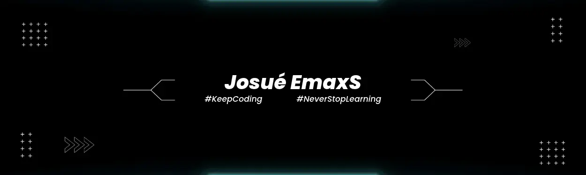

 

  

<h3 align="center">
    
</h3>

  I build web applications and backend systems, focusing on maintainable code, practical solutions, and reliable software.

  
  

---

## 🛠️ Technical Skills

#### Programming Languages

  

#### Frontend Development

  

#### Backend Development

  

#### Databases & ORMs

  

#### Testing & API Development

  

#### DevOps & Development Tools

  

---

## 📊 GitHub Statistics

  
  
  

